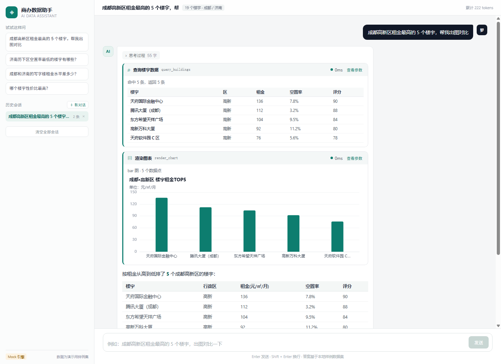

# AI 对话式数据助手（商办楼宇）

一个可运行的 **Vue3 + Node** AI 应用 Demo：用一句话查询楼宇数据，模型通过**工具调用**取数并渲染图表，前端全程 **SSE 流式**输出，并把每次工具调用的参数、状态、耗时、结果可视化出来。

> 数据集为演示用样例（19 个商办楼宇，覆盖成都 / 济南），不含真实商业数据。



## 快速开始

```bash
# Node 18+（本机验证环境为 Node 22）
npm install

npm run dev
```

- **前端：http://localhost:5179**（后端 5178，Vite 已配好 `/api` 代理）
- 打开后点左侧示例问题即可；加 `?demo=1` 会自动跑第一条示例，方便录屏 / 截图

**无需 API Key**：未配置密钥时使用内置 Mock 引擎，可完整演示流式输出、工具调用与图表。
配置 `.env`（参考 `.env.example`）后可切换到任意 OpenAI 兼容的大模型接口。

```bash
npm run build     # 构建前端产物到 web/dist
npm run preview   # 由 Node 服务直接托管构建产物
```

## 目录结构

```
ai-data-assistant/
├── server/
│   ├── index.js          # Express + SSE 接口、上下文压缩、降级兜底
│   ├── llm.js            # 模型层：OpenAI 兼容流式 + 内置 Mock 引擎
│   ├── tools.js          # 工具定义（JSON Schema）与执行器
│   └── data/buildings.json
├── web/
│   ├── vite.config.js    # /api 代理到 5178
│   └── src/
│       ├── App.vue               # 布局、会话切换、输入区
│       ├── composables/useChat.js # SSE 客户端、消息状态机、本地持久化
│       ├── components/
│       │   ├── MessageItem.vue   # 消息渲染（思考过程 / 工具卡片 / 正文）
│       │   ├── ToolCallCard.vue  # 工具调用可视化
│       │   └── ChartView.vue     # ECharts 渲染图表 spec
│       └── utils/markdown.js     # 轻量 Markdown 渲染（先转义再解析）
└── .env.example
```

## 核心链路

```
用户提问
   │
   ▼
POST /api/chat  ────────────────►  server/index.js
                                    │  ① 上下文压缩（>10 条 → 摘要 + 最近 6 条）
                                    │  ② 调模型（带 tools 定义）
                                    ▼
                         模型返回 tool_calls
                                    │  ③ 执行 query_buildings / render_chart
                                    ▼
   SSE 逐条回推 ◄──────────────  ④ 把工具结果回灌模型，继续生成
   start / reasoning / delta / tool_call / tool_result / usage / done / error
```

### 两个工具

| 工具 | 作用 | 参数 |
| --- | --- | --- |
| `query_buildings` | 查楼宇数据 | city / district / sortBy(rent·vacancy·score) / order / limit |
| `render_chart` | 生成图表 spec | type(bar·line·pie) / title / unit / data[] |

`render_chart` 不生成图片，只返回结构化 spec，由前端 ECharts 渲染——图表可交互、可换肤，也方便后续导出。

## 已实现的前端能力

- **SSE 流式渲染**：`fetch` + `ReadableStream` 手写事件解析，逐 token 追加
- **思考过程折叠**：模型返回的 reasoning 单独成块，默认收起
- **工具调用可视化**：调用中 → 完成 / 失败，展示参数 JSON、耗时、结果摘要与数据表
- **结果即图表**：图表卡片随工具结果即时渲染，随窗口自适应缩放
- **多轮上下文**：服务端裁剪 + 摘要，客户端展示“上下文已压缩”提示
- **会话持久化**：localStorage 保存多会话，可切换 / 删除 / 清空
- **中断与重试**：`AbortController` 停止生成；网络异常自动重试一次，失败给出降级文案
- **用量与耗时**：每条回答显示 prompt/completion tokens 与总耗时，顶部显示会话累计

## 面试可以怎么讲

1. **为什么用 SSE 而不是 WebSocket**：单向流式、走 HTTP、免握手与连接管理；只有需要双向低延迟时才上 WebSocket。
2. **工具调用的循环怎么收敛**：`tool_calls` → 执行 → 以 `role: tool` 回灌 → 再次请求；限制最多 3 轮，避免模型无限调工具。
3. **上下文压缩的取舍**：确定性规则（摘要 + 最近 N 条）成本低、可控；真实业务可用小模型摘要，但要多一次调用成本。
4. **流式带来的渲染压力**：每 3 个字触发一次渲染，用「同类区块合并追加 + 单一 text 节点」避免整棵树重建；超长表格做横向滚动容器。
5. **包体积治理**：ECharts 从全量引入改为按需注册（core + Bar/Line/Pie + Grid/Tooltip/Title + Canvas），构建产物 1,120KB → 589KB（gzip 205KB）。
6. **降级设计**：模型挂了不能白屏——数据接口本身可用，仍展示工具结果，并给用户明确的重试路径。
7. **防幻觉**：用户只问「哪个楼宇性价比最高」时，模型不猜城市，而是反问「哪个城市 / 关注哪个指标」。工具参数由模型生成，但取数一律走真实查询，不让模型自己编数字。

## 部署

前端必须和后端一起跑（SSE 流 + 工具执行需要 Node 常驻），所以**不能丢到 GitHub Pages / 纯静态托管**。三种可行方式：

**A. Docker（有自己的服务器时推荐）**

```bash
docker build -t ai-data-assistant .
# 不配 key 就是 Mock 引擎演示
docker run -d --name ai-data -p 5178:5178 ai-data-assistant
# 接真实模型
docker run -d --name ai-data -p 5178:5178 -e OPENAI_API_KEY=sk-xxx -e OPENAI_MODEL=gpt-4o-mini ai-data-assistant
```

镜像做了多阶段构建：构建期装全量依赖产出 `web/dist`，运行期只保留 `server` + `dist` + 生产依赖，并带 `/api/health` 健康检查。

**B. Railway / Render / 轻量云主机（不想折腾 Docker）**

- Build：`npm install && npm run build`
- Start：`node server/index.js`
- 环境变量：`OPENAI_API_KEY` / `OPENAI_BASE_URL` / `OPENAI_MODEL`（不配走 Mock）
- 端口读 `PORT`，服务会同时托管 API 和前端静态文件，一个端口就够

**C. 本地生产预览**

```bash
npm run build && npm run preview   # 打开 http://localhost:5178
```

部署后自检：

```bash
curl http://<host>:5178/api/health          # 期望 {"ok":true,"engine":"mock"|"openai",...}
```

## 简历文案 ↔ 代码位置

面试官追问「这块你具体怎么做的」时，可以直接对着文件讲：

| 简历里的说法 | 对应实现 |
| --- | --- |
| SSE 流式输出，逐字渲染 | `server/index.js` 的 `sendEvent` + `web/src/composables/useChat.js` 的 `runStream`（自行解析 `ReadableStream`） |
| 工具调用（Function Calling）+ 参数校验 | `server/tools.js` 定义 JSON Schema，`server/llm.js` 聚合 `tool_calls` 增量并最多循环 3 轮 |
| 图表由工具返回 spec 交前端渲染 | `render_chart` 只返回结构化数据，`web/src/components/ChartView.vue` 用 ECharts 按需渲染 |
| 多轮上下文压缩 | `server/index.js` 的 `compressHistory`（>10 条转摘要 + 保留最近 6 条） |
| 中断 / 重试 / 降级 | `useChat.js` 的 `AbortController` 与一次性自动重试；`MessageItem.vue` 的错误态与「重新生成」 |
| 轻量 Markdown 渲染、避免 XSS | `web/src/utils/markdown.js` 先转义再解析，不走 `v-html` 直出原文 |

## 后续可加

- 工具结果缓存（相同查询参数命中本地缓存，省 token）
- 图表 spec → 导出 PNG / CSV
- 多轮里做「指代消解」（“第一名”指向上一轮结果）
- 用 `zod` 校验工具参数，替代手写分支
